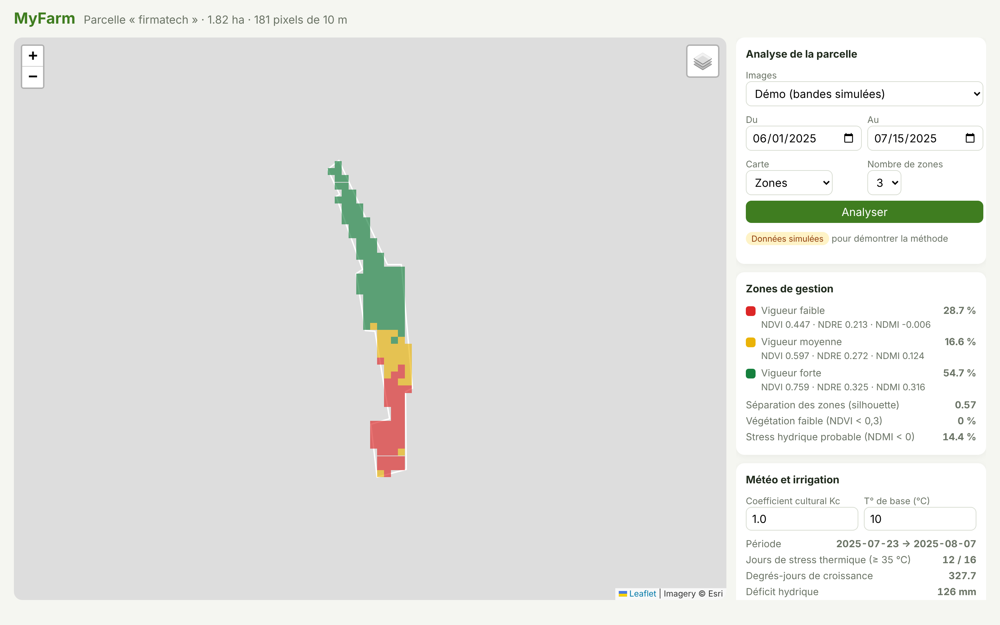

# MyFarm — Precision Agriculture for One Parcel

[](https://github.com/Haytamzerr/myfarm/actions/workflows/tests.yml)

MyFarm turns a field drawn in Google Earth into a precision-agriculture dashboard:

- **vegetation maps** at 10 m resolution from Sentinel-2 satellite images (NDVI, NDRE, NDMI, EVI, GNDVI);
- **management zones**: the parcel split into areas of low, medium and high vigour, where irrigation, fertiliser or scouting can be adjusted;
- **weather and irrigation**: heat stress, growing degree days and the water the crop needs, in mm and in m³ for the whole parcel.

It's built for a real 1.8 ha parcel near Fès-Meknès (Morocco).



## How it works

```
 firmatech.kml ──► Parcel ──► 10 m grid (181 pixels)
                                  │
     Sentinel-2 (STAC, AWS) ──────┤   or a simulated scene for the demo
                                  ▼
                    bands ──► vegetation indices ──► k-means ──► management zones
                                                                      │
 Open-Meteo CSV ──► daily weather ──► GDD, heat stress, ET0 × Kc ─────┤
                                                                      ▼
                                              FastAPI  ──►  Leaflet map dashboard
```

### 1. The parcel
The polygon is read from a KML file exported from Google Earth. It's projected onto a local flat plane to measure its area (1.82 ha) and to place one point every 10 m, which is the size of a Sentinel-2 pixel.

### 2. Satellite images
[Sentinel-2](https://sentinels.copernicus.eu/web/sentinel/missions/sentinel-2) photographs every field every ~5 days. The images are public Cloud-Optimised GeoTIFFs on AWS, indexed in the [Earth Search](https://earth-search.aws.element84.com/v1) STAC catalogue. `myfarm.sentinel`:
- searches the catalogue for the least cloudy image in a date range;
- reads only the pixels under the grid over HTTP, without downloading the whole image;
- converts digital numbers to reflectance (scale and offset of the processing baseline);
- removes pixels the scene classification marks as cloud, shadow or snow.

### 3. Vegetation indices

| Index | Formula | Shows |
|---|---|---|
| NDVI | (NIR − Red) / (NIR + Red) | amount of green vegetation |
| NDRE | (NIR − RedEdge) / (NIR + RedEdge) | chlorophyll / nitrogen, still sensitive in dense crops |
| NDMI | (NIR − SWIR) / (NIR + SWIR) | water in the leaves, an early sign of water stress |
| EVI | 2.5 (NIR − Red) / (NIR + 6 Red − 7.5 Blue + 1) | vegetation, corrected for soil and haze |
| GNDVI | (NIR − Green) / (NIR + Green) | chlorophyll |

### 4. Management zones (unsupervised)
NDVI, NDRE and NDMI are standardised, then grouped with **k-means**. Groups are ranked by mean NDVI, so zone 0 is always the weakest. The silhouette score measures how well separated the zones are and picks the best number of zones (2 to 4). Simple flags are kept separate: low vegetation (NDVI < 0.3) and probable water stress (NDMI < 0).

### 5. Weather and irrigation
From an [Open-Meteo](https://open-meteo.com) export:
- **growing degree days**: `max(0, (Tmax + Tmin)/2 − base)`;
- **heat-stress days**: Tmax ≥ 35 °C;
- **crop water need**: FAO-56 reference evapotranspiration × crop coefficient Kc;
- **water balance**: rain − need, which gives the deficit irrigation must cover (1 mm over 1 ha = 10 m³).

For the period in the repository (23 July to 7 August 2025): 12 heat-stress days out of 16, and a deficit of 126 mm, about **2,300 m³** of water for the parcel at Kc = 1.

## What I learned: the 100 % accuracy trap

My first version (a notebook) trained Random Forest, XGBoost, Gradient Boosting and SVM to predict "fertility", "water stress" and so on, and every model reached **100 % accuracy**. That looked great until I noticed two problems:

1. **Data leakage.** The label was made from the input itself: *fertile = NDVI > 0.4*, predicted from NDVI. Any model learns that threshold perfectly. `zones.leakage_demo` reproduces it: even on pure random numbers it scores ~100 % (there's a test for it).
2. **No ground truth.** The bands were random numbers, and there were no soil samples or yields to check against.

Without real labels, a supervised model can't be evaluated honestly. So this version does what the data can support: **unsupervised zones** on real (or clearly labelled simulated) reflectance, plus explicit rules of thumb. The next step for supervised learning would be to collect labels in the field (soil analyses, yield per zone).

## Run it

```bash
git clone https://github.com/Haytamzerr/myfarm.git
cd myfarm
pip install -r requirements.txt
python -m myfarm serve
```

Open <http://localhost:8000>. The **Démo** mode works offline with a simulated scene, which is clearly marked as such on the page.

### Real satellite images

```bash
pip install -r requirements-satellite.txt
python -m myfarm scan --source sentinel --start 2025-06-01 --end 2025-07-15 --out zones.csv
```

You can also choose **Sentinel-2 réel** in the dashboard. Both need internet access.

### Your own parcel
Draw it in Google Earth, export it as KML, then:
```bash
MYFARM_PARCEL=path/to/field.kml MYFARM_WEATHER=path/to/open-meteo.csv python -m myfarm serve
```
(PowerShell: `$env:MYFARM_PARCEL="field.kml"; python -m myfarm serve`)

### Tests
```bash
pip install pytest httpx
pytest
```
23 tests: geometry (the area of a known 1 ha square, one point per pixel), indices (known values, no division by zero), zones (ordered and reproducible, cloudy pixels ignored), the leakage trap, weather (degree days, m³ conversion), the Sentinel-2 reader (scaling, offset and cloud mask, with the network faked) and the API.

## API

| Path | What it returns |
|---|---|
| `GET /api/parcel` | the parcel as GeoJSON, its area and number of pixels |
| `GET /api/scan?source=demo\|sentinel&start=&end=&k=` | indices, zone and flags of every pixel, plus a zone summary |
| `GET /api/weather?kc=&base=` | daily indicators and irrigation totals |

Interactive docs: <http://localhost:8000/docs>

## Project structure

```
myfarm/
  parcel.py     KML reading, area, 10 m grid
  sentinel.py   Sentinel-2 search and pixel reading (STAC + COG)
  synthetic.py  simulated scene for the offline demo
  indices.py    NDVI, NDRE, NDMI, EVI, GNDVI
  zones.py      k-means management zones, flags, leakage demonstration
  weather.py    Open-Meteo reader, degree days, water balance
  api.py        FastAPI endpoints
static/         Leaflet + Chart.js dashboard
data/           the parcel (KML) and a weather export
tests/          pytest suite
```

## Roadmap
- Time series: NDVI through the season from every clear Sentinel-2 image
- Fetch the weather directly from the Open-Meteo API instead of an export
- Field labels (soil analyses, yield) to train and validate a real supervised model
- Per-zone irrigation advice combining NDMI with the water balance
